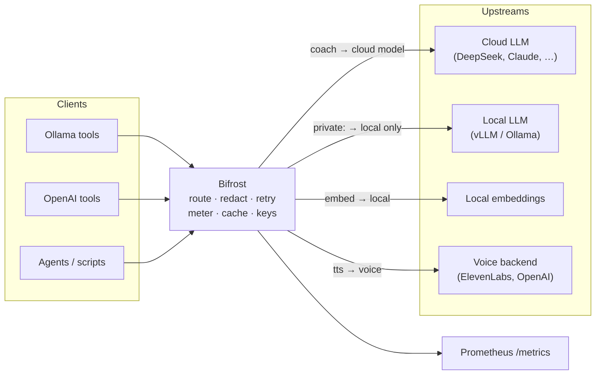

<p align="center">
  
</p>

<h1 align="center">Bifrost</h1>

<p align="center"><strong>One endpoint for every LLM you run.</strong></p>

Bifrost is an Ollama-compatible *and* OpenAI-compatible gateway that fronts every
AI backend you own — cloud and local — behind a single URL, and puts routing,
privacy, resilience, metering and caching at that seam. Point any tool at it and
it works.

Named for the Norse rainbow bridge: it carries requests from Ollama and OpenAI
clients (Midgard) to the models (Asgard).



## Objectives

These are the reasons the project exists. Features are judged against them; a
feature that doesn't serve one of these is scope, not progress.

1. **One door, every backend.** Clients speak a single API. Adding a vendor,
   a model, or a whole second provider should be a config change — never a
   change to the tools that talk to it.
2. **Policy lives at the seam.** Which requests may leave the network, and in
   what form, is decided by the gateway rather than trusted to every caller.
   Privacy is enforced, not documented.
3. **Failure is the normal case.** Cloud APIs rate-limit, local workers go
   offline, keys get revoked. Callers see a slow success, never an internal
   failure.
4. **Attribution, not just totals.** It isn't enough to know the fleet spent
   money. Every request is accounted to the app that made it — tokens,
   characters, cost — so spend is a fact about a caller, not a monthly number.
5. **Small enough to read.** One static binary, standard library only, no
   database, no queue, no sidecar, no daemon. If a capability needs external
   state to work, it doesn't ship.

## Features

### Routing and compatibility

- **Multi-backend routing** — `BACKENDS` declares upstreams, `ROUTES` maps
  client model names to `backend/upstream-model`. Aliases (`coach`) let you
  change the model behind a name without touching clients; unknown names pass
  through to the default backend unchanged. See
  [Configuration](docs/CONFIGURATION.md#multi-backend-recommended).
- **Two client dialects** — the Ollama API and the OpenAI API, served from the
  same port. A tool that only speaks one can reach a backend that only speaks
  the other.
- **Model catalog** — `GET /v1/models` returns each model's privacy tier,
  backend, upstream name, capabilities and per-1M-token pricing, so agents can
  discover what's available instead of hardcoding names.
- **Speech** — `POST /v1/audio/speech` (OpenAI shape) in front of any voice
  backend, selected by `kind: openai` or `kind: elevenlabs`, with the same
  fallback semantics as chat. Routes live in `AUDIO_ROUTES` so a voice target
  never appears as a chat model.
- **Embeddings** — Ollama and OpenAI embedding endpoints, routed to whichever
  backend holds an embedding model.

### Privacy

- **`private:` routing** — a model whose name begins with `private:` must
  resolve to a local backend. There is no wildcard: you add an explicit route
  (`"private:qwen": "local/qwen3-14b"`), and if it would land on a cloud
  backend the request is refused with a `400` instead of leaking.
- **PII redaction** — emails, phone numbers, card numbers, SSNs, IPs, API/SSH
  keys and PEM private keys are scrubbed from cloud-bound traffic. Local
  backends are detected (loopback, RFC1918, `.lab`) and skip it.

### Resilience

- **Retries and failover** — transient failures are retried with exponential
  backoff, then walk a `FALLBACKS` chain before anything reaches the client.
  Applies to streaming, `/v1` passthrough and embeddings, not just
  non-streaming chat.
- **Circuit breakers** — a backend that keeps failing is failed fast instead of
  hung on, and half-opens to re-admit traffic once it recovers.
- **Health polling** — backends are probed on an interval so the first request
  after an outage fails over immediately instead of paying the retry cost.
- **Key pool** — a backend can hold many keys on different plans. Bifrost
  rotates across them weighted round-robin and cools the offending key on a
  `429`/`401`/`403` before backend failover applies.

### Governance and observability

- **Tenant keys** — Bifrost mints its own client keys (`POST /admin/keys`) and
  keeps only their SHA-256, so a stolen key file cannot authenticate. Each key
  carries its own monthly budget and rate limit, its own spend and last-used
  stamp, and can be revoked without a restart. Anonymous callers are a policy
  choice: `open`, `limited` (per-IP rate limit plus a shared monthly cap) or
  `closed`. Every ledger line records both the tenant and the key that spent it.
- **Budgets** — hard monthly limits, global (`BUDGET`) and per app
  (`APP_BUDGETS`), backed by a durable JSONL ledger so they survive restarts.
  Over budget → `402`, rate-limited → `429`, unauthenticated → `401`.
- **Per-app auth and rate limits** — `APP_KEYS` (imported as static tenant keys)
  and `RATE_LIMIT`.
- **Ledger** — every request appends tokens, cost and characters
  (`LEDGER_FILE`), which is what makes spend attributable rather than guessed.
- **Metrics** — Prometheus `/metrics` with tokens, cost, latency, errors,
  cache hits, retries, fallbacks and key rotations.
- **Live dashboard** — `/dashboard` updates in place from `/dashboard.json`
  every two seconds: no reloads, no dropped scroll position, and it re-lays-out
  as labelled cards on a phone.

### Caching

- **Exact-match** — identical requests skip the upstream call entirely. Bounded
  LRU with TTL, in memory only (responses can echo request PII, so they are
  never persisted).
- **Semantic** — opt-in near-neighbour cache using a local embedding backend;
  a reworded question can hit cache. Degrades gracefully when that backend is
  down.

### Deployment

- **One static binary** — standard library only, `FROM scratch`, no runtime
  dependencies, ~13 MB stripped image payload.
- **Multi-arch** — `linux/amd64` and `linux/arm64` images, so it runs on a
  server, a NUC or a Pi.
- **Runs outside our cluster** — a compose example, a `docker run` one-liner and
  a deploying guide that assume nothing about our infrastructure. State is two
  plain files on a volume; the image carries its own `/data` with the right
  owner and a `HEALTHCHECK`, and shuts down on `SIGTERM` by draining. A CI job
  starts it on a fresh volume, mints a key, restarts, and checks the key and the
  spend are still there — so "runs elsewhere" is tested, not hoped.

## Planned

Roughly in priority order. Everything is an increment on the above, not a
rewrite.

- **More vendor dialects behind `kind`** — a native Anthropic backend is the
  next one, so Claude is a route entry rather than a proxy.
- **Per-plan accounting** — spend broken out by the key pool's `plan` label, so
  "this month ran on the off-peak key" is a number rather than an inference.
  Per-tenant spend already appears in `/admin/keys`.

## Not planned

- **A model runner** — vLLM and llama.cpp own that.
- **A training pipeline.**
- **A vector database or retrieval service** — delegate to a real store.
- **An admin UI as a product** — the dashboard is for reading, not for
  operating a fleet of tenants.

Bifrost stays thin on purpose: its value is the decision layer, not the compute.

## Quick start

With compose — a gateway plus a local model, no API key required:

```bash
git clone https://github.com/StevenGann/bifrost.git
cd bifrost/deploy/compose
cp .env.example .env      # set ADMIN_KEY, point BACKENDS at your model
docker compose up -d
curl -s localhost:11434/v1/models
```

Or one container, straight from the registry:

```bash
docker run -d --name bifrost -p 11434:11434 \
  -e UPSTREAM_API_KEY=sk-... \
  ghcr.io/stevengann/bifrost:latest
```

Then point any Ollama or OpenAI client at `http://<host>:11434`. That's the
whole pitch: one command, and every tool that speaks those APIs now talks to
your entire fleet through Bifrost.

To front more than one backend, replace the single upstream with a routing
table:

```bash
docker run -d --name bifrost -p 11434:11434 \
  -e BACKENDS='[{"name":"cloud","base_url":"https://api.deepseek.com","api_key_env":"CLOUD_KEY"},{"name":"local","base_url":"http://192.0.2.10:11434","local":true}]' \
  -e ROUTES='{"coach":"cloud/deepseek-v4-flash","private:qwen":"local/qwen3-14b","embed":"local/nomic-embed-text"}' \
  -e FALLBACKS='{"coach":"private:qwen"}' \
  -e CLOUD_KEY=sk-... \
  ghcr.io/stevengann/bifrost:latest
```

## Documentation

- **[Architecture](docs/ARCHITECTURE.md)** — request lifecycle, routing,
  resilience, key pool, privacy, observability, code layout.
- **[Configuration](docs/CONFIGURATION.md)** — the full environment reference.
- **[Deploying](docs/DEPLOYING.md)** — running it outside our cluster: compose, state, secrets, what to back up.
- **[Contributing](docs/CONTRIBUTING.md)** — build, test, extend.
- **[Roadmap](docs/ROADMAP.md)** — the longer version of the plan above.

## License

MIT. See [LICENSE](LICENSE).
